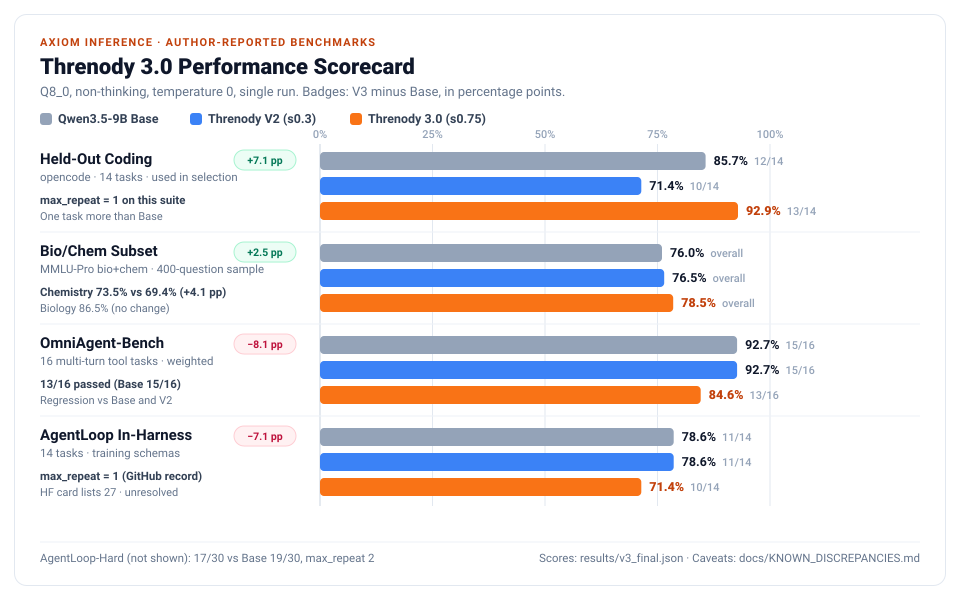

# Threnody 3.0

> *threnody* — a song of lamentation for the dead. An elegy for every bug it meets.

**Threnody 3.0** (`Threnody-9B V3`) is an **experimental agentic-coding fine-tune of `Qwen/Qwen3.5-9B`** by **Axiom Inference**. It is trained for multi-turn coding and tool calling across 8 harness schemas (6 used in training, 2 held out), plus biology/chemistry reasoning. It was trained with supervised fine-tuning using LoRA; the adapter was merged at strength 0.75.

- **Developer / Creator**: **Axiom Inference**
- **Base Architecture**: `Qwen/Qwen3.5-9B`
- **License**: Apache-2.0
- **Hugging Face**: [MalxTech/Threnody-9B-V3-GGUF](https://huggingface.co/MalxTech/Threnody-9B-V3-GGUF)
- **Abliteration**: Layers 12–28 directional refusal orthogonalization (Arditi et al., 2024)

> **The author ran and reported all benchmarks; no third party has reproduced them.** Several published records disagree with each other or with the code. See [Known discrepancies and evaluation limitations](#known-discrepancies-and-evaluation-limitations).

---

## Benchmark Scorecard (V3 vs. V2 vs. Base)



Conditions per `pipeline/run_v3.sh`: Q8_0 GGUF builds, pinned chat template, temperature 0, non-thinking mode only. Differences are in **percentage points (pp)**, computed from pass counts.

| Benchmark Suite | Qwen3.5-9B Base | Threnody-9B V2 (`s0.3`) | **Threnody 3.0 (`s0.75`)** | V3 vs. Base |
|---|---|---|---|---|
| **AgentLoop Held-Out (`opencode`, 14)** ¹ | 12/14 (85.7%) | 10/14 (71.4%) | **13/14 (92.9%)** | **+7.1 pp** (+1 task); V3 `max_repeat = 1` |
| **MMLU-Pro biology + chemistry, 400-question subset** ² | 76.0% | 76.5% | **78.5%** | **+2.5 pp** |
| ↳ Biology | 86.5% | not in current record ³ | **86.5%** | 0.0 pp |
| ↳ Chemistry | 69.4% | not in current record ³ | **73.5%** | **+4.1 pp** |
| **OmniAgent-Bench (weighted, 16)** | 92.7% (15/16) | 92.7% (15/16) | **84.6% (13/16)** | **−8.1 pp** |
| **AgentLoop In-Harness (14)** | 11/14 (78.6%) | 11/14 (78.6%) | **10/14 (71.4%)** | **−7.1 pp** (−1 task); V3 `max_repeat = 1` ⁴ |
| **AgentLoop-Hard (30 held-out)** | 19/30 (63.3%) | N/A | **17/30 (56.7%)** | **−6.7 pp** (−2 tasks); V3 `max_repeat = 2` |

¹ The `opencode` suite also feeds the score used to choose the checkpoint and the release candidate, so it is not a clean held-out estimate.
² A fixed random sample of MMLU-Pro biology + chemistry test questions. This is **not** an overall MMLU-Pro score.
³ The current record gives V2 subset scores only for a different test (BioChem-Hard: biology 44.5%, chemistry 14.1%). Comparing those with V3's MMLU-Pro subsets would mix two tests.
⁴ The Hugging Face card reports `rep=27` for this cell. The conflict is unresolved.

Summary metrics: [`results/v3_final.json`](results/v3_final.json). **Note:** that file and `results/v3_gate_s0.75.json` record the release as passing its gates. Those records do not match the gate criteria in the current `pipeline/gates.py`, which this candidate would fail (details in [`docs/KNOWN_DISCREPANCIES.md` §4](docs/KNOWN_DISCREPANCIES.md#4-gate-records-vs-gate-code)).

---

## The 6 Pillars of V3

1. **Reasoning traces kept in training data**: interleaved `<think>` scratchpads are kept in about 75% of trajectories. No thinking-mode V3 benchmark results are published.
2. **Anti-loop training-data filter**: `build_v3.py` drops any training trajectory with `max_repeat >= 2` (an identical action repeated back-to-back). Measured on the released model, as the longest run of identical consecutive actions across all tasks in a suite: **1** on `opencode` held-out, **1** on AgentLoop In-Harness (GitHub record; the HF card says 27), **2** on AgentLoop-Hard.
3. **Multi-curriculum mix: 35M-token target, 2.9M tokens reported**: `run_v3.sh` sets a **35M-token target** (`--total_tokens 35e6`). The run reported **2,895,493 tokens across 662 trajectories** (`results/v3_training_report.json`). Planned shares:
   - 35% multi-schema agent traces (8 tool schemas)
   - 20% verified algorithmic coding (`code_verified.jsonl`)
   - 20% Open-SWE-Traces
   - 15% BioChem reasoning (`sci_v2.jsonl`)
   - 10% cybersecurity & tool schema (`regen.jsonl` + identity)

   The training report labels these shares differently (35% Open-SWE-Traces, 20% `swe_traces`). See [discrepancies §3.2](docs/KNOWN_DISCREPANCIES.md#32-data-mix-percentages-disagree).
4. **Supervised fine-tuning using LoRA**: `pipeline/train_sft.py` trains LoRA adapters (rank 64, alpha 32 by default) on the decoder linear layers. It uses chunked cross-entropy and assistant-only loss on an A100-80GB. The adapter was merged at strength 0.75 (`merge.py`), so the merged weights carry 75% of the trained update. The training report's batch size and other settings disagree with the trainer code; the settings that actually ran are **unverified** ([§3.3](docs/KNOWN_DISCREPANCIES.md#33-hyperparameters-report-vs-trainer-code-vs-launch-script)).
5. **Directional refusal orthogonalization**: Arditi et al. abliteration on layers 12–28 after merging, aimed at removing false refusals on legitimate CLI and security tooling. No quantitative refusal or safety evaluation is published.
6. **Separate vision projector**: the multimodal projector (`mmproj-F16`) ships at F16 next to the text GGUF ladder. No vision evaluation is published.

---

## Download & Quant Ladder (GGUF)

Hugging Face Repository: **[MalxTech/Threnody-9B-V3-GGUF](https://huggingface.co/MalxTech/Threnody-9B-V3-GGUF)**

Each quant was compared with the BF16 GGUF of the same model over 40 × 4096-token chunks of `val.jsonl`, the same text used for imatrix calibration (`results/v3_quant_report.json`). "Same top token" is the percentage of positions where the quant's most likely token matches BF16's. **These metrics measure token-distribution agreement only. No coding or agent benchmark was run per quant, so they do not show equal task performance.**

| Binary File | Disk Size | Same Top Token vs. BF16 | Median KLD | Notes |
|---|---|---|---|---|
| `Threnody-9B-V3-Q8_0.gguf` | 8.87 GB | 97.756% | 0.000088 | Build used for the published benchmarks |
| `Threnody-9B-V3-Q6_K.gguf` | 6.85 GB | 96.664% | 0.000246 | |
| `Threnody-9B-V3-Q5_K_M.gguf` | 6.02 GB | 96.127% | 0.000426 | |
| `Threnody-9B-V3-Q4_K_M.gguf` | 5.24 GB | 94.058% | 0.001219 | |
| `Threnody-9B-V3-IQ4_XS.gguf` | 4.84 GB | 93.161% | 0.001749 | |
| `Threnody-9B-V3-IQ3_M.gguf` | 4.20 GB | 89.615% | 0.007465 | Top token differs from BF16 at ~10.4% of positions |
| `mmproj-Threnody-9B-V3-F16.gguf` | 0.92 GB | N/A (F16) | N/A | Vision projector |

---

## Known discrepancies and evaluation limitations

All scores above come unchanged from the published files. Where records conflict, this section does not say which one is correct. Full details, with file and line references: [`docs/KNOWN_DISCREPANCIES.md`](docs/KNOWN_DISCREPANCIES.md).

**Limitations**
- **Author-reported.** All benchmarks were run and reported by the author. V3 per-task outputs and run logs are not in this repository.
- **`opencode` influenced selection.** `gates.fast_score()` includes the `opencode` pass count, and both the checkpoint gate and the candidate ranking use it. The 13/14 result suggests transfer to that tested held-out schema. Fourteen tasks cannot establish general tool understanding.
- **Science scope.** The science scores cover a 400-question sample of MMLU-Pro **biology and chemistry** questions, not overall MMLU-Pro.
- **Small suites, one seed, non-thinking only.** One task is 7.1 pp on a 14-task suite. No confidence intervals are reported.
- **Mixed results vs. Base.** V3 improves on `opencode` (+7.1 pp) and the bio/chem subset (+2.5 pp). It is lower on OmniAgent-Bench (−8.1 pp), AgentLoop In-Harness (−7.1 pp) and AgentLoop-Hard (−6.7 pp).

**Unresolved conflicts between records**
- **Gate pass vs. gate code**: `v3_final.json` / `v3_gate_s0.75.json` record `pass: true`, but neither `gate_v3()` nor the `mid` gate `run_v3.sh` calls would pass this candidate. No revision in this repository's history contains the published gate criteria.
- **Superseded `s1.0` result set**: commit `52edc9f` published a different, all-passing `s1.0` result set, including different scores for the same base model.
- **Training configuration**: the report says batch 4 × accumulation 8; `train_sft.py` hard-codes batch 1 and `run_v3.sh` leaves accumulation at 16. Warmup, weight decay and optimizer also differ. No run log is published.
- **Token count**: 35M is the configuration target; 2,895,493 tokens were reported for the run.
- **Repetition metric**: AgentLoop In-Harness `max_repeat` is 1 on GitHub and 27 on the Hugging Face card.
- **Science records**: V2's MMLU-Pro (76.5%) and BioChem-Hard (37.6%) overall scores sit side by side in `v3_final.json`. `biochem_hard_final.json` reports Base BioChem-Hard at 25.36% (844 questions), while `v3_final.json` reports 76.0%.
- **Red-team file**: `v3_redteam_report.json` does not match the output format of `eval/redteam/harness.py` and has no counts.

---

## Ollama Usage & Modelfile

### Text-Only Agentic Model:
Save as `Modelfile`:
```dockerfile
FROM ./Threnody-9B-V3-Q4_K_M.gguf

TEMPLATE """{{ if .System }}<|im_start|>system
{{ .System }}<|im_end|>
{{ end }}{{ range .Messages }}{{ if eq .Role "user" }}<|im_start|>user
{{ .Content }}<|im_end|>
{{ else if eq .Role "assistant" }}<|im_start|>assistant
{{ .Content }}<|im_end|>
{{ end }}{{ end }}<|im_start|>assistant
"""

PARAMETER stop "<|im_start|>"
PARAMETER stop "<|im_end|>"
PARAMETER temperature 0.6
PARAMETER top_p 0.95
```

Build and launch:
```bash
ollama create threnody-v3 -f Modelfile
ollama run threnody-v3
```

### Multimodal Vision Model (Vision + Agentic Text):
Save as `Modelfile.vision`:
```dockerfile
FROM ./Threnody-9B-V3-Q4_K_M.gguf
ADAPTER ./mmproj-Threnody-9B-V3-F16.gguf

TEMPLATE """{{ if .System }}<|im_start|>system
{{ .System }}<|im_end|>
{{ end }}{{ range .Messages }}{{ if eq .Role "user" }}<|im_start|>user
{{ .Content }}<|im_end|>
{{ else if eq .Role "assistant" }}<|im_start|>assistant
{{ .Content }}<|im_end|>
{{ end }}{{ end }}<|im_start|>assistant
"""

PARAMETER stop "<|im_start|>"
PARAMETER stop "<|im_end|>"
PARAMETER temperature 0.6
PARAMETER top_p 0.95
```

---

## Inference with llama.cpp

### Local Server:
```bash
llama-server -m Threnody-9B-V3-Q4_K_M.gguf -ngl 99 -c 32768 -fa on -ctk q8_0 -ctv q8_0 --jinja
```

### With Multimodal Vision Projector:
```bash
llama-server -m Threnody-9B-V3-Q4_K_M.gguf --mmproj mmproj-Threnody-9B-V3-F16.gguf -ngl 99 -c 32768 -fa on --jinja
```

---

## Repository Structure
```
docs/           05_V4_PLAN.md, bench_v3.svg, KNOWN_DISCREPANCIES.md, HF_MODEL_CARD.md, postmortem, progress log, status
eval/           AgentLoop harness + 8 tool schemas (6 train, 2 held-out)
notebooks/      Threnody.ipynb (Colab A100 execution runbook)
pipeline/       build_v3.py, run_v3.sh, train_sft.py, abliterate.py, gates.py, export_gguf.py, publish_hf.py
results/        v3_final.json, gate records, training/quant/red-team reports (see docs/KNOWN_DISCREPANCIES.md)
```

## License
Apache-2.0
