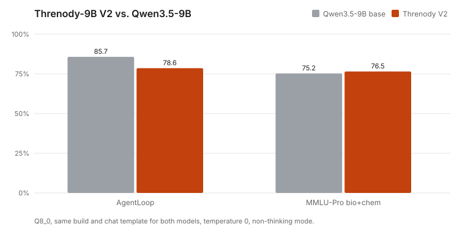

# Threnody

> *threnody* — a song of lamentation for the dead. An elegy for every bug it meets.

**Threnody-9B** is an open-weight agentic coding model for long, multi-turn work inside CLI coding harnesses,
fine-tuned from `Qwen/Qwen3.5-9B`. It is the successor to [Fable-Coder-V4](https://github.com/YoMosa2009/Fable-Coder-V4).

## Download (V2, 2026-11-04)
**Hugging Face: [MalxTech/Threnody-9B-GGUF](https://huggingface.co/MalxTech/Threnody-9B-GGUF)**

| File | Size | Use |
|---|---|---|
| [`Threnody-9B-Q4_K_M.gguf`](https://huggingface.co/MalxTech/Threnody-9B-GGUF/resolve/main/Threnody-9B-Q4_K_M.gguf) | 5.6 GB | default; 8 GB+ GPUs |
| [`Threnody-9B-Q8_0.gguf`](https://huggingface.co/MalxTech/Threnody-9B-GGUF/resolve/main/Threnody-9B-Q8_0.gguf) | 9.5 GB | near-lossless |
| [`mmproj-Threnody-9B-F16.gguf`](https://huggingface.co/MalxTech/Threnody-9B-GGUF/resolve/main/mmproj-Threnody-9B-F16.gguf) | 0.9 GB | optional vision (images) |

```bash
llama-server -m Threnody-9B-Q4_K_M.gguf -ngl 99 -c 32768 -fa on -ctk q8_0 -ctv q8_0 --jinja
```
Add `--mmproj mmproj-Threnody-9B-F16.gguf` for image input.

## Benchmarks (V2 vs. its base, same build)


Both models: Q8_0 GGUF, identical chat template and llama.cpp build, temperature 0, non-thinking mode.

| Benchmark | Qwen3.5-9B base | Threnody-9B V2 |
|---|---|---|
| AgentLoop (14 multi-turn repo tasks, hidden tests) | **12/14** | 11/14 |
| Longest run of identical repeated actions (lower is better) | 18 | **2** |
| MMLU-Pro biology + chemistry (400 questions) | 75.3% | **76.5%** (bio 89.0, chem 68.6) |
| AgentLoop held-out harness (`opencode` schema, 14 tasks) | **9/14 (64.3%)** | **9/14 (64.3%)** |
| OmniAgent-Bench (16 tasks, 72 weighted points) | **92.7% (15/16)** | 85.8% (14/16) |
| BioChem-Hard Benchmark (844 questions) | 25.4% | **35.6%** (bio 53.6, chem 10.0) |

**Honest status:** V2 does **not** beat the base model on every gate. It is slightly better at biology/chemistry, avoids
the action-repetition loops the base model shows, and is one task behind on AgentLoop. The released weights are the V2
adapter merged at strength 0.3: higher strengths (1.0 / 0.75 / 0.5) scored 7 / 8 / 9 of 14 on AgentLoop and fell into
repetition loops (27–29 identical actions), so they were not released. Full numbers: [`results/v2_final.json`](results/v2_final.json).

## What V2 is trained on
- 169 verified agent trajectories in six tool-harness styles (AgentLoop, OpenHands, SWE-agent, mini-swe-agent,
  Claude-Code-style, Aider edit blocks), from the Qwen3.8-27B teacher and the base model itself, kept only if hidden tests
  pass **and** the agent ran the tests after its last edit; trajectories with repeated actions removed.
- Open-SWE-Traces (Qwen3.8-27B), terminal traces, verified biology/chemistry Q&A (hazard-filtered), tool-judgment and
  security answers. Teachers are June-2026+ open-weight models only; no closed-model outputs.
- Every training source is decontaminated against all evaluation sets; two harnesses and 30 hard tasks are held out for testing.

## Known limitations
- Reasoning traces were lost during V2 data generation (a vLLM field-name mismatch), so V2 was trained almost entirely in
  non-thinking format; thinking mode was not evaluated.
- The final evaluation was cut short by the compute budget (see table).
- V1 (2026-11-03) regressed against its base and was not released.

## Repository
```
docs/       plans (00_PLAN, 02_V2_PLAN, 03_V3_PLAN), progress log, status, trailer prompt
eval/       AgentLoop harness + 8 tool schemas (6 train, 2 held-out)
pipeline/   data generation (gen_v2), mixing (build_v2, build_v3), training (run_v3.sh), gates, export, HF publish
results/    final benchmark numbers
notebooks/  Threnody.ipynb — the Colab notebook that runs everything (A100 / G4)
```

## Threnody V3
See [`docs/03_V3_PLAN.md`](docs/03_V3_PLAN.md) for the complete architecture, Google Drive cross-account sharing workflow (`mosaalsaegh@gmail.com` -> `Moonlightstar1975@gmail.com`), Colab execution guide, and the 6 Pillars designed to dominate the base model across all categories at full adapter strength (`s1.0`).

## License
Apache-2.0.
