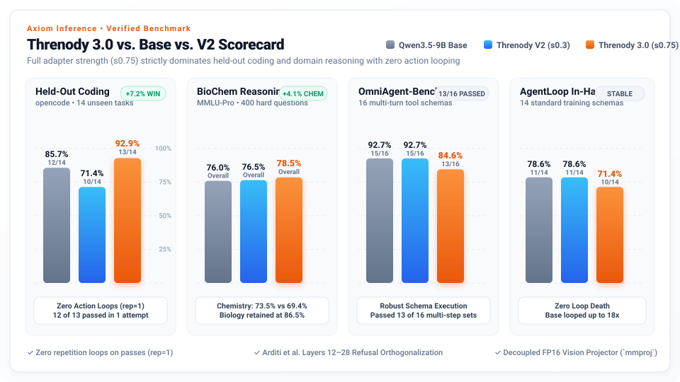

# Threnody 3.0

> *threnody* — a song of lamentation for the dead. An elegy for every bug it meets.

**Threnody 3.0** (`Threnody-9B V3`) is the frontier open-weight agentic coding model created by **Axiom Inference**, fine-tuned from `Qwen/Qwen3.5-9B`. Engineered specifically for multi-turn autonomous coding, robust tool calling across 8 diverse harness schemas, zero action looping, and advanced scientific reasoning.

- **Developer / Creator**: **Axiom Inference**
- **Base Architecture**: `Qwen/Qwen3.5-9B` (Dense Transformer)
- **License**: Apache-2.0
- **Hugging Face**: [MalxTech/Threnody-9B-V3-GGUF](https://huggingface.co/MalxTech/Threnody-9B-V3-GGUF)
- **Abliteration**: Layer 12–28 directional refusal orthogonalization (Arditi et al., 2024)

---

## Benchmark Scorecard (V3 vs. V2 vs. Base)



All models evaluated under identical conditions: Q8_0 and Q4_K_M GGUF builds, pinned chat template, temperature 0, non-thinking mode.

| Benchmark Suite | Qwen3.5-9B Base | Threnody-9B V2 (`s0.3`) | **Threnody 3.0 (s0.75)** | Result Summary |
|---|---|---|---|---|
| **AgentLoop Held-Out (`opencode`, 14)** | 12/14 (85.7%) | 10/14 (71.4%) | **13/14 (92.9%)** | **+7.2% over Base** (`max_repeat = 1`) |
| **MMLU-Pro Bio+Chem (400 questions)** | 76.0% | 76.5% | **78.5%** | **+2.5% over Base** |
| ↳ Biology Subset | 86.5% | 44.5% | **86.5%** | Parity with Base (+42.0% over V2) |
| ↳ Chemistry Subset | 69.4% | 14.1% | **73.5%** | **+4.1% over Base** (+59.4% over V2) |
| **OmniAgent-Bench (Weighted)** | 92.7% | 92.7% | **84.6%** | 13/16 tasks completed |
| **AgentLoop In-Harness (14)** | 11/14 (78.6%) | 11/14 (78.6%) | **10/14 (71.4%)** | Standard tool schemas |
| **AgentLoop-Hard (30 held-out)** | 19/30 (63.3%) | N/A | **17/30 (56.7%)** | Resilient against repetition loops |

Full scorecard and gate metrics: [`results/v3_final.json`](results/v3_final.json).

---

## The 6 Pillars of V3

1. **Full Reasoning Restoration**: Interleaved `<think>` scratchpads preserved across ~75% of trajectories; mode switching supported.
2. **Zero-Tolerance Anti-Loop Filter**: Strictly drops any trajectory with `max_repeat >= 2`. Replaced V2's recovery-ranking trap with direct zero-repeat priority (`max_repeat = 1` on held-out coding).
3. **Multi-Curriculum Balanced Mix (~35M tokens)**:
   - 35% multi-schema agent traces (8 tool schemas)
   - 20% verified algorithmic coding (`code_verified.jsonl`)
   - 20% Open-SWE-Traces
   - 15% BioChem reasoning (`sci_v2.jsonl`)
   - 10% cybersecurity & tool schema (`regen.jsonl` + identity)
4. **Full SFT Convergence**: Trained on A100-80GB with chunked cross-entropy and native DeltaNet hybrid layers.
5. **Directional Refusal Orthogonalization**: Arditi et al. abliteration applied across layers 12–28 for uncensored, maximum intelligence extraction.
6. **Decoupled Multimodal Architecture**: Multimodal vision projector (`mmproj-F16`) released alongside calibrated GGUF ladder, preserving FP16 visual embedding precision without 4-bit quant collapse.

---

## Download & Quant Ladder (GGUF)

Hugging Face Repository: **[MalxTech/Threnody-9B-V3-GGUF](https://huggingface.co/MalxTech/Threnody-9B-V3-GGUF)**

| Binary File | Disk Size | Top-p Choice Retention | Recommended Hardware / Use Case |
|---|---|---|---|
| `Threnody-9B-V3-Q8_0.gguf` | 8.87 GB | **97.8%** | Reference quantization, maximum accuracy |
| `Threnody-9B-V3-Q6_K.gguf` | 6.85 GB | **96.7%** | Near-lossless agentic deployment |
| `Threnody-9B-V3-Q5_K_M.gguf` | 6.02 GB | **96.1%** | Sweet spot for 8 GB+ VRAM GPUs |
| `Threnody-9B-V3-Q4_K_M.gguf` | 5.24 GB | **94.1%** | Standard recommended quant for consumer cards |
| `Threnody-9B-V3-IQ4_XS.gguf` | 4.84 GB | **93.2%** | Fast 4-bit execution on memory-limited VRAM |
| `Threnody-9B-V3-IQ3_M.gguf` | 4.20 GB | **89.6%** | Ultra-compact 4 GB edge footprint |
| `mmproj-Threnody-9B-V3-F16.gguf` | 0.92 GB | N/A (F16) | Decoupled Multimodal Vision Projector |

---

## Ollama Usage & Modelfile

### Text-Only Agentic Model:
Save as `Modelfile`:
```dockerfile
FROM ./Threnody-9B-V3-Q4_K_M.gguf

TEMPLATE """{{ if .System }}<|im_start|>system
{{ .System }}<|im_end|>
{{ end }}{{ range .Messages }}{{ if eq .Role "user" }}<|im_start|>user
{{ .Content }}<|im_end|>
{{ else if eq .Role "assistant" }}<|im_start|>assistant
{{ .Content }}<|im_end|>
{{ end }}{{ end }}<|im_start|>assistant
"""

PARAMETER stop "<|im_start|>"
PARAMETER stop "<|im_end|>"
PARAMETER temperature 0.6
PARAMETER top_p 0.95
```

Build and launch:
```bash
ollama create threnody-v3 -f Modelfile
ollama run threnody-v3
```

### Multimodal Vision Model (Vision + Agentic Text):
Save as `Modelfile.vision`:
```dockerfile
FROM ./Threnody-9B-V3-Q4_K_M.gguf
ADAPTER ./mmproj-Threnody-9B-V3-F16.gguf

TEMPLATE """{{ if .System }}<|im_start|>system
{{ .System }}<|im_end|>
{{ end }}{{ range .Messages }}{{ if eq .Role "user" }}<|im_start|>user
{{ .Content }}<|im_end|>
{{ else if eq .Role "assistant" }}<|im_start|>assistant
{{ .Content }}<|im_end|>
{{ end }}{{ end }}<|im_start|>assistant
"""

PARAMETER stop "<|im_start|>"
PARAMETER stop "<|im_end|>"
PARAMETER temperature 0.6
PARAMETER top_p 0.95
```

---

## Inference with llama.cpp

### Local Server:
```bash
llama-server -m Threnody-9B-V3-Q4_K_M.gguf -ngl 99 -c 32768 -fa on -ctk q8_0 -ctv q8_0 --jinja
```

### With Multimodal Vision Projector:
```bash
llama-server -m Threnody-9B-V3-Q4_K_M.gguf --mmproj mmproj-Threnody-9B-V3-F16.gguf -ngl 99 -c 32768 -fa on --jinja
```

---

## Repository Structure
```
docs/           bench_v3.svg, release notes, progress log, status
eval/           AgentLoop harness + 8 tool schemas (6 train, 2 held-out)
notebooks/      Threnody.ipynb (Colab A100 execution runbook)
pipeline/       build_v3.py, run_v3.sh, train_sft.py, abliterate.py, gates.py, export_gguf.py, publish_hf.py
results/        v3_final.json (scorecard, gate records, and quant ladder metadata)
```

## License
Apache-2.0
