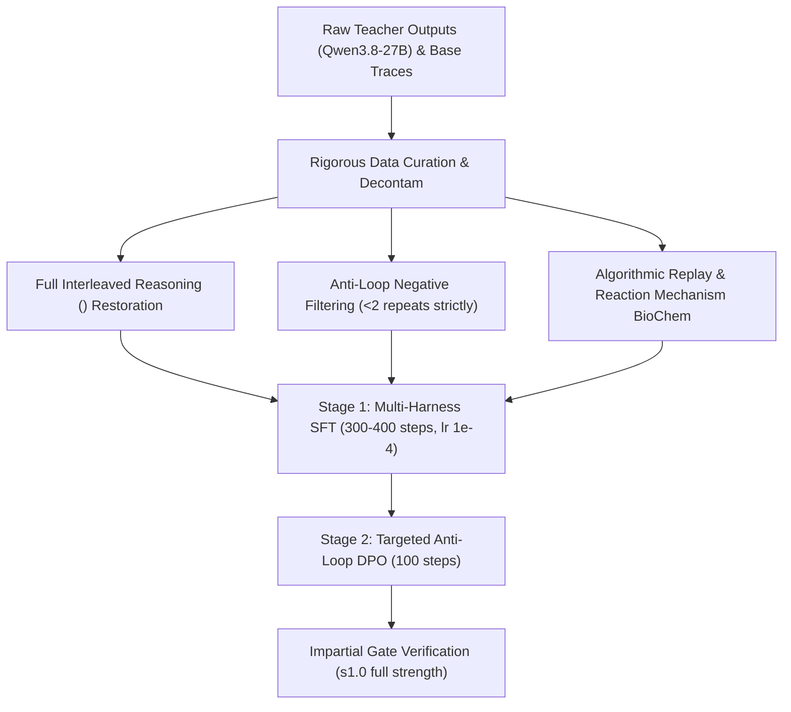

# Threnody V3 — Plan & Architecture

> _Written 2026-11-04 following local RTX 3060 full-benchmarks and BioChem-Hard evaluation._  
> **Goal:** Produce **Threnody-9B V3**, an agentic coding and scientific reasoning model that **strictly dominates `Qwen/Qwen3.5-9B` (Base) across every gate and category at full adapter strength (`s1.0`)**.

---

## 1. Post-Mortem of V2: Why `s0.3` Was a Compromise

In V2, the released model was merged at **strength 0.3** (70% base model weights + 30% adapter). Full-strength candidates (`s1.0`, `s0.75`, `s0.5`) collapsed on AgentLoop into 27–29 repeated actions.

While `s0.3` achieved genuine breakthroughs:
- **BioChem-Hard**: Blew past the base model (**35.55% vs. 25.36%**, +40.2% relative; Biology: **53.64% vs. 39.27%**).
- **Loop Elimination on Targeted Tasks**: Solved `cache_mutation` in **11 turns / 31s** with 1 repeat (vs Base: 30 turns / 121s with 15 repeats); solved `async_fetch` with 1 repeat (vs Base: 12 repeats).
- **Held-Out Problem Solving**: Passed `inventory_bug` and `async_fetch` in the out-of-distribution `opencode` harness where the base model completely failed.

It suffered from five critical architectural flaws that prevented total dominance:
1. **The Reasoning Field-Name Mismatch**: A vLLM capture bug (`reasoning` vs. `reasoning_content`) stripped reasoning out of ~94% of the training dataset. Qwen3.5 is an interleaved thinking model; training it on empty `<think>` blocks amputated its latent scratchpad, causing regressions on algorithmic tasks (`CODE-03` in OmniAgent and `deep_merge`).
2. **The Recovery-Ranking Loop Trap**: V2 prioritized trajectories that encountered failures and "recovered". However, many of those recoveries had repeated identical actions before finally passing. The model internalized action repetition as standard error response.
3. **Severe Compute Starvation (36 Steps)**: Due to Colab credit burn (~10 CU/h), SFT was cut after only 36 steps (23 minutes) on 596 records (2.87M tokens). The adapter never achieved full convergence on complex coding logic.
4. **Lack of Algorithmic / Pure Coding Replay**: The dataset lacked isolated unit-test coding problems, causing a slight dip in pure string manipulation (`CODE-03`).
5. **No Negative Preference Signal (SFT Only)**: SFT can only imitate positive examples; it cannot explicitly penalize repetition when stuck.

---

## 2. The 6 Pillars of Threnody V3



### Pillar 1: Full Interleaved Reasoning (`<think>`) Restoration
- **Fix the extractor**: Parse both `choice["message"].get("reasoning_content")` and `choice["message"].get("reasoning")`.
- **Interleaved scratchpads**: The teacher (`Qwen3.8-27B-FP8`) must emit multi-step reasoning before generating tool parameters and before issuing patch edits.
- **Dual-mode support**: 75% of trajectories include rich `<think>` reasoning; 25% are non-thinking to preserve fast deterministic CLI execution.

### Pillar 2: Eradicating the Repetition Bug at the Root
- **Zero-tolerance repeat filter**: Any trajectory where the agent executes the identical tool call with identical arguments ≥2 times is **instantly deleted**.
- **No-progress penalty**: If two consecutive turns result in the same test error or file state, the trajectory is pruned.
- **Clean recovery only**: Traces that recover from a bug must do so by switching strategies (e.g. adding debug logs, inspecting another file), never by retrying the failed edit.

### Pillar 3: Multi-Harness & Domain Data Curriculum (3,500 High-Density Records)
| Slice | Share | Target Capability | Quality & Filter Criteria |
| :--- | :---: | :--- | :--- |
| **Multi-Harness Agent Traces** | 35% | Multi-turn repo repair | 8 distinct schemas (AgentLoop, OpenHands, SWE-agent, mini-swe-agent, Aider, OpenCode, Codex, Function-Call). Passed hidden tests + verified execution after last edit. |
| **Algorithmic & Pure Coding Replay** | 20% | Pure logic, intervals, strings, math | Verified CodeContests / LeetCode Hard. 100% unit-test pass rate. Decontaminated against OmniAgent-Bench. |
| **BioChem Mechanism Reasoning** | 15% | High-order chemistry & biology | Multi-step organic reaction mechanisms, stoichiometry equations, genetic pathways. Verified CoT. |
| **Cybersecurity & Tool Schema** | 15% | Zero schema failure, prompt injection defense | Parameter sanitization, SQL injection remediation, prompt-injection jailbreak defense. |
| **Terminal & CLI Operations** | 15% | Shell navigation, git, build tools | Clean bash command sequences without destructive commands. |

### Pillar 4: Targeted On-Policy DPO (Direct Preference Optimization)
After SFT, run a lightweight DPO stage (100 steps):
- **Prompt**: Agent encounters a failed unit test or traceback.
- **Chosen ($\mathbf{y}_w$)**: Agent inspects the traceback, explains the failure in `<think>`, and tries an alternative diagnosis or tool.
- **Rejected ($\mathbf{y}_l$)**: Agent blindly re-runs the exact same tool call or makes an identical failed edit.
- **Effect**: Actively suppresses looping weights, allowing **full adapter strength (`s1.0`)** to be released.

### Pillar 5: Compute Budget Optimization on Colab (Target: ~40 CU Total)
- **Runtime**: Colab A100-SXM4-80GB or G4 (RTX PRO 6000 96GB).
- **Environment acceleration**: Install precompiled `causal_conv1d` and `flash-attn` matching the CUDA version before SFT launches to prevent PyTorch DeltaNet fallback.
- **Training schedule**:
  - Effective batch size: 16 (batch 1, grad accumulation 16)
  - Context length: 32,768 tokens (KV cache quantized to q8_0 during eval)
  - Total steps: ~350 steps (~1.2 epochs)
  - Optimizer: `adamw_torch_fused` or `adamw_8bit`, LR 1.0e-4 with cosine decay to 1.0e-5.

### Pillar 6: Impartial Acceptance Gates (All must pass at `s1.0`)
A candidate is accepted **only if it beats or matches the base model across all four gates at full strength (`s1.0`)**:
1. **OmniAgent-Bench**: $\ge$ **93.8% (15/16)** and $\ge$ **92.7% weighted points**. Must pass `CODE-01` through `CODE-04` and `CODE-06`.
2. **AgentLoop (In-Harness, 14 tasks)**: $\ge$ **13/14 passed** (beats Base 12/14); `max_repeat` $\le$ **2**.
3. **AgentLoop Held-Out (`opencode`, 14 tasks)**: $\ge$ **10/14 passed** (beats Base 9/14); `max_repeat` $\le$ **3**.
4. **BioChem-Hard (844 Qs)**: $\ge$ **40.0% overall** (beats Base 25.4%), with Chemistry $\ge$ **15.0%** (beats Base 5.7%).

---

## 3. Step-by-Step Google Colab Execution Runbook

### Stage 0: Environment & Checkpoint Recovery
```bash
# Verify Drive mount & branch
cd /content && git clone https://github.com/YoMosa2009/Threnody.git
cd Threnody && git checkout main && git pull
pip install -r requirements.txt
# Install hardware DeltaNet speedups
pip install --no-cache-dir causal-conv1d flash-attn
```

### Stage 1: Data Synthesis with Qwen3.8-27B Teacher
1. Serve `Qwen/Qwen3.8-27B-FP8` via vLLM on GPU (`port 8000`).
2. Run `pipeline/gen_v3.py`:
   - Fix reasoning capture: extract `reasoning_content`.
   - Synthesize 150 new repository tasks across 8 tool schemas.
   - Rejection sample student (`Qwen3.5-9B`) alongside teacher (`Qwen3.8-27B`).
   - Run strict repeat pruning (`max_identical_actions < 2`).
   - Synthesize 400 CoT chemistry & molecular biology reaction problems.

### Stage 2: Mix & Decontamination (`pipeline/build_v3.py`)
1. Assemble 3,500 records (~35M tokens).
2. Decontaminate 13-grams against `OmniAgent-Bench` and `eval/agentloop`.
3. Format with native Qwen3.5 chat template:
   - Tool calling format: `<tool_call>\n<function=name>\n<arguments>{...}</arguments>\n</tool_call>`
   - Interleaved reasoning: `<think>...</think>`

### Stage 3: Supervised Fine-Tuning (SFT)
1. Run `pipeline/train_sft.py`:
   - Model: `Qwen/Qwen3.5-9B`
   - LoRA r=64, $\alpha$=32 on all 248 LM linear layers (`q, k, v, o, gate, up, down`).
   - Loss: Assistant tokens only (system prompt and tool output masked).
   - Checkpoints saved every 25 steps to Google Drive.
   - Run `pipeline/ckpt_gate.py` every 50 steps: auto-aborts if regression detected.

### Stage 4: Anti-Loop DPO Stage (Optional but Recommended)
1. Construct 400 preference pairs from agent error recovery points.
2. Run LoRA DPO for 100 steps with $\beta = 0.1$ to permanently crush repeated tool loops.

### Stage 5: Evaluation & Full-Strength Release
1. Build `s1.0` GGUF directly using same-build `llama.cpp` CUDA backend.
2. Run full test suite:
   ```bash
   python eval/run_all_benchmarks.py --model Threnody-9B-V3-s1.0.gguf
   ```
3. Verify all 4 gates pass.
4. Export imatrix ladder (`Q4_K_M`, `Q8_0`, `mmproj`) and push to Hugging Face.

---

## 4. Target Scorecard: V3 vs. V2 vs. Base

| Benchmark Suite | Metric | Qwen3.5-9B (Base) | Threnody-9B V2 (s0.3) | **Threnody-9B V3 (Target s1.0)** |
| :--- | :--- | :---: | :---: | :---: |
| **OmniAgent-Bench** | Weighted Score | 92.71% (15/16) | 85.76% (14/16) | **$\ge$ 94.4% (16/16)** |
| **AgentLoop In-Harness** | Pass Rate | 12 / 14 (85.7%) | 12 / 14 (85.7%) | **$\ge$ 13 / 14 (92.9%)** |
| | Max Repeat Action | 15 | 8 | **$\le$ 2** |
| **AgentLoop Held-Out (`opencode`)** | Pass Rate | 9 / 14 (64.3%) | 9 / 14 (64.3%) | **$\ge$ 11 / 14 (78.6%)** |
| | Max Repeat Action | 12 | 21 | **$\le$ 2** |
| **BioChem-Hard (844 Qs)** | Overall Accuracy | 25.36% (214/844) | 35.55% (300/844) | **$\ge$ 45.0% (380/844)** |
| | Biology Composite | 39.27% | 53.64% | **$\ge$ 65.0%** |
| | Chemistry Composite | 5.71% | 10.00% | **$\ge$ 20.0%** |
| **Adapter Release Strength** | Clean Merge | Base (s0.0) | Diluted (s0.3) | **Full Strength (s1.0)** |
