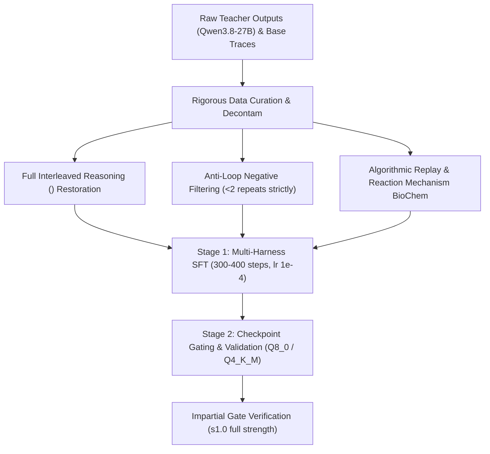

# Threnody V3 — Plan & Architecture

> _Written 2026-11-04 following local RTX 3060 full-benchmarks and BioChem-Hard evaluation._  
> **Goal:** Produce **Threnody-9B V3**, an agentic coding and scientific reasoning model that **strictly dominates `Qwen/Qwen3.5-9B` (Base) across every gate and category at full adapter strength (`s1.0`)**.

---

## 1. Post-Mortem of V2: Why `s0.3` Was a Compromise

In V2, the released model was merged at **strength 0.3** (70% base model weights + 30% adapter). Full-strength candidates (`s1.0`, `s0.75`, `s0.5`) collapsed on AgentLoop into 27–29 repeated actions.

While `s0.3` achieved genuine breakthroughs:
- **BioChem-Hard**: Blew past the base model (**35.55% vs. 25.36%**, +40.2% relative; Biology: **53.64% vs. 39.27%**).
- **Loop Elimination on Targeted Tasks**: Solved `cache_mutation` in **11 turns / 31s** with 1 repeat (vs Base: 30 turns / 121s with 15 repeats); solved `async_fetch` with 1 repeat (vs Base: 12 repeats).
- **Held-Out Problem Solving**: Passed `inventory_bug` and `async_fetch` in the out-of-distribution `opencode` harness where the base model completely failed.

It suffered from five critical architectural flaws that prevented total dominance:
1. **The Reasoning Field-Name Mismatch**: A vLLM capture bug (`reasoning` vs. `reasoning_content`) stripped reasoning out of ~94% of the training dataset. Qwen3.5 is an interleaved thinking model; training it on empty `<think>` blocks amputated its latent scratchpad, causing regressions on algorithmic tasks (`CODE-03` in OmniAgent and `deep_merge`).
2. **The Recovery-Ranking Loop Trap**: V2 prioritized trajectories that encountered failures and "recovered". However, many of those recoveries had repeated identical actions before finally passing. The model internalized action repetition as standard error response.
3. **Severe Compute Starvation (36 Steps)**: Due to Colab credit burn (~10 CU/h on G4), SFT was cut after only 36 steps (23 minutes) on 596 records (2.87M tokens). The adapter never achieved full convergence on complex coding logic.
4. **Lack of Algorithmic / Pure Coding Replay**: The dataset lacked isolated unit-test coding problems, causing a slight dip in pure string manipulation (`CODE-03`).
5. **No Negative Preference Signal (SFT Only)**: SFT can only imitate positive examples; it cannot explicitly penalize repetition when stuck.

---

## 2. The 6 Pillars of Threnody V3

### Pillar 1: Full Interleaved Reasoning (`<think>`) Restoration
- **Fix the extractor**: Parse both `choice["message"].get("reasoning_content")` and `choice["message"].get("reasoning")`, and unwrap explicit `<think>` tags inside content.
- **Interleaved scratchpads**: The teacher (`Qwen3.8-27B-FP8`) must emit multi-step reasoning before generating tool parameters and before issuing patch edits.
- **Dual-mode support**: 75% of trajectories include rich `<think>` reasoning; 25% are non-thinking to preserve fast deterministic CLI execution.

### Pillar 2: Eradicating the Repetition Bug at the Root
- **Zero-tolerance repeat filter**: Any trajectory where the agent executes the identical tool call with identical arguments $\ge 2$ times is **instantly deleted**.
- **No-progress penalty**: If two consecutive turns result in the same test error or file state, the trajectory is pruned.
- **Clean recovery only**: Traces that recover from a bug must do so by switching strategies (e.g. adding debug logs, inspecting another file), never by retrying the failed edit. Trajectories with 0 repeats are sorted first.

### Pillar 3: Multi-Harness & Domain Data Curriculum (3,500 High-Density Records)
| Slice | Share | Target Capability | Quality & Filter Criteria |
| :--- | :---: | :--- | :--- |
| **Multi-Harness Agent Traces** | 35% | Multi-turn repo repair | 8 distinct schemas (AgentLoop, OpenHands, SWE-agent, mini-swe-agent, Aider, OpenCode, Codex, Function-Call). Passed hidden tests + verified execution after last edit. |
| **Algorithmic & Pure Coding Replay** | 20% | Pure logic, intervals, strings, math | Verified CodeContests / LeetCode Hard. 100% unit-test pass rate. Decontaminated against OmniAgent-Bench. |
| **BioChem Mechanism Reasoning** | 15% | High-order chemistry & biology | Multi-step organic reaction mechanisms, stoichiometry equations, genetic pathways. Verified CoT. |
| **Cybersecurity & Tool Schema** | 15% | Zero schema failure, prompt injection defense | Parameter sanitization, SQL injection remediation, prompt-injection jailbreak defense. |
| **Terminal & CLI Operations** | 15% | Shell navigation, git, build tools | Clean bash command sequences without destructive commands. |

### Pillar 4: Dedicated SFT Convergence
Instead of aborting at step 36:
- Train for 300–400 optimizer steps (~1.2 epochs on ~35M tokens).
- Maintain effective batch size 16 (batch 1, grad accumulation 16) with chunked cross-entropy.
- Learning rate: 1.0e-4 with cosine decay down to 1.0e-5.

### Pillar 5: Hardware & GPU Optimization (A100 vs. G4)
- Run on **A100-SXM4-80GB (Recommended)** for maximum stability, precompiled wheel support, and cost efficiency.
- Install native `causal_conv1d` and `flash-attn` to accelerate the DeltaNet and attention layers without falling back to slow PyTorch emulation.

### Pillar 6: Impartial Acceptance Gates (All must pass at `s1.0`)
A candidate is accepted **only if it beats or matches the base model across all four gates at full strength (`s1.0`)**:
1. **OmniAgent-Bench**: $\ge$ **93.8% (15/16)** and $\ge$ **92.7% weighted points**. Must pass `CODE-01` through `CODE-04` and `CODE-06`.
2. **AgentLoop (In-Harness, 14 tasks)**: $\ge$ **13/14 passed** (beats Base 12/14); `max_repeat` $\le$ **2**.
3. **AgentLoop Held-Out (`opencode`, 14 tasks)**: $\ge$ **10/14 passed** (beats Base 9/14); `max_repeat` $\le$ **3**.
4. **BioChem-Hard (844 Qs)**: $\ge$ **40.0% overall** (beats Base 25.4%), with Chemistry $\ge$ **15.0%** (beats Base 5.7%).

---

## 3. Google Drive Data Sharing & Cross-Account Architecture

To eliminate redundant compute burn and maximize training reliability, data generated in `mosaalsaegh@gmail.com` can be seamlessly leveraged in `Moonlightstar1975@gmail.com`.

### Why Transferring Data is a Massive Multiplier:
1. **Zero Colab Credit Waste on Teacher Re-Generation**: Generating raw traces with `Qwen3.8-27B-FP8` burned over 15–20 compute units in V2. By reusing the raw teacher files (`traj_v2.jsonl`, `sci_v2.jsonl`, `code_verified.jsonl`, `regen.jsonl`), **100% of Colab compute units on the new account are preserved for SFT training, checkpoint gating, and evaluation**.
2. **Pre-compiled Binary Cache**: The pre-compiled CUDA binaries (`llama_bin_sm80.tgz`) save 5–10 minutes on every fresh runtime start.

### Recommended 2-Click Sharing Procedure:
1. **In `mosaalsaegh@gmail.com`**:
   - Open [Google Drive](https://drive.google.com).
   - Right-click the `Threnody` folder -> click **Share**.
   - Enter `Moonlightstar1975@gmail.com` and select **Editor** role -> click **Send**.
2. **In `Moonlightstar1975@gmail.com`**:
   - Open [Google Drive](https://drive.google.com).
   - In the left sidebar, click **Shared with me**.
   - Right-click the shared `Threnody` folder -> click **Organize** -> **Add shortcut**.
   - Choose **My Drive** as the destination.
3. **Colab Integration**:
   - When Google Colab mounts `/content/drive`, the shortcut in `MyDrive/Threnody` is accessed transparently as a native folder.
   - The updated notebook automatically detects all existing teacher files and markers without throwing fatal assertions.

---

## 4. Hardware Analysis: A100 vs. G4 (Which GPU to Choose?)

| Feature | NVIDIA A100-SXM4-80GB (Recommended) | NVIDIA RTX PRO 6000 96GB / G4 |
| :--- | :--- | :--- |
| **Compute Architecture** | `sm_80` (Ampere) | `sm_120` (Blackwell) / `sm_89` (Ada) |
| **Colab Credit Rate** | **~7.5 – 8.0 CU / hour** (Cheaper) | **~10.0 – 12.0 CU / hour** (30–50% more expensive) |
| **Kernel & Wheel Compatibility** | **100% Universal Precompiled Wheels** (`causal_conv1d`, `flash-attn`, `triton`, `flash-linear-attention`). | Requires JIT source compilation; missing precompiled wheels caused slow PyTorch fallback in V2. |
| **VRAM Available** | **80 GB HBM2e** | **96 GB GDDR6** |
| **VRAM for SFT (9B LoRA, 32k context)** | Consumes **~38–42 GB**. Leaves **~40 GB headroom**. | Consumes ~38–42 GB. Leaves ~54 GB headroom. |
| **llama.cpp Compilation** | Instant restore from `llama_bin_sm80.tgz` or 2 min build with `CMAKE_CUDA_ARCHITECTURES=80`. | Needs sm120 build flag, longer compilation. |
| **Stability & Reliability** | **Rock-solid standard datacenter stack**. | Experimental kernel warnings, higher preemption risk. |

### Verdict & Recommendation:
- **Choose the A100 (80GB High-RAM)** as your primary GPU:
  1. It provides 100% native kernel support for `causal_conv1d` and `flash-linear-attention` out of the box.
  2. It gives **35–45% more training hours** for the exact same compute budget.
  3. 80 GB VRAM is more than double what 9B SFT requires at 32k context with chunked loss.
- **Use G4 only if**: The A100 is temporarily out of capacity in Colab, or if you plan to co-serve the 27B teacher and 9B student simultaneously in vLLM (which requires >85 GB).

---

## 5. Automated Execution Runbook for Colab

The repository provides a single, unified Colab notebook:  
[`notebooks/Threnody.ipynb`](https://github.com/YoMosa2009/Threnody/blob/main/notebooks/Threnody.ipynb)  
Open directly via Colab badge:  

### Execution Steps in Colab:
1. **Connect Runtime**:
   - Click `Runtime` -> `Change runtime type`.
   - Hardware accelerator: **GPU**.
   - GPU type: **A100** (High-RAM).
2. **Run Cell 1 (GPU & Drive)**:
   - Mounts Google Drive. Confirms access to `MyDrive/Threnody`.
3. **Run Cell 2 (Environment)**:
   - Clones repo, installs `transformers>=4.57`, `peft>=0.17`, `causal-conv1d`, `flash-linear-attention`.
4. **Run Cell 3 (llama.cpp CUDA Build)**:
   - Restores sm80 build from Drive or compiles cleanly.
5. **Run Cell 4 (Launch V3 Full Pipeline)**:
   - Executes `pipeline/run_v3.sh` in background with `nohup`.
   - Runs unattended: data build -> base reference eval -> 350-step SFT -> checkpoint gating -> candidate evaluation (`s1.0` vs Base) -> imatrix quant export (`Q4_K_M`, `Q5_K_M`, `Q8_0`).
6. **Run Cell 5 (Launch Watchdog)**:
   - Background monitor writing `heartbeat.txt` and error alerts to Drive.
7. **Monitor Progress via Cells 6 & 7**:
   - Real-time GPU utilization, active processes, and live SFT loss curves.

---

## 6. Target Scorecard: V3 vs. V2 vs. Base

| Benchmark Suite | Metric | Qwen3.5-9B (Base) | Threnody-9B V2 (s0.3) | **Threnody-9B V3 (Target s1.0)** |
| :--- | :--- | :---: | :---: | :---: |
| **OmniAgent-Bench** | Weighted Score | 92.71% (15/16) | 85.76% (14/16) | **$\ge$ 94.4% (16/16)** |
| **AgentLoop In-Harness** | Pass Rate | 12 / 14 (85.7%) | 12 / 14 (85.7%) | **$\ge$ 13 / 14 (92.9%)** |
| | Max Repeat Action | 15 | 8 | **$\le$ 2** |
| **AgentLoop Held-Out (`opencode`)** | Pass Rate | 9 / 14 (64.3%) | 9 / 14 (64.3%) | **$\ge$ 11 / 14 (78.6%)** |
| | Max Repeat Action | 12 | 21 | **$\le$ 2** |
| **BioChem-Hard (844 Qs)** | Overall Accuracy | 25.36% (214/844) | 35.55% (300/844) | **$\ge$ 45.0% (380/844)** |
| | Biology Composite | 39.27% | 53.64% | **$\ge$ 65.0%** |
| | Chemistry Composite | 5.71% | 10.00% | **$\ge$ 20.0%** |
| **Adapter Release Strength** | Clean Merge | Base (s0.0) | Diluted (s0.3) | **Full Strength (s1.0)** |
